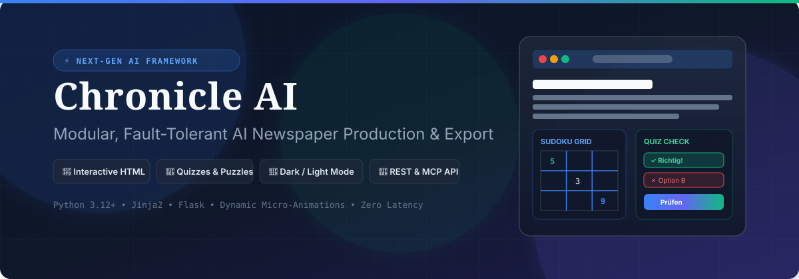

<p align="center">
  
</p>

# Chronicle AI – Newspaper Framework for LLMs

[](https://www.python.org/downloads/)
[](LICENSE)
[](#-ausführung--verifikation)

**Chronicle AI** ist ein modulares, fehlerstolerantes Python-Framework zur automatisierten und KI-gestützten Zeitungsproduktion. Es ermöglicht Large Language Models (LLMs) und autonomen Agenten, hochwertige, interaktive Zeitungen mit Artikeln, Bildern, Quizzes, Sudoku- und Kreuzworträtseln zu generieren.

Die Ausgaben werden als moderne, voll interaktive HTML-Dateien mit integrierter JavaScript-Logik oder als strukturiertes JSON exportiert.

---

## 🎨 CI & Design System ("Chronicle Modern Editorial")

Das Framework beinhaltet ein maßgeschneidertes Design-System und Corporate Identity (CI) für ansprechende digitale Zeitungen:

- **Marken-Identität**: Modernes SVG-Logo (`assets/logo.svg`) und Projektbanner (`assets/banner.svg`).
- **Dark & Light Mode**: Automatische Erkennung der Systemeinstellung (`prefers-color-scheme`) mit manuellem Umschalter und dauerhafter `localStorage`-Speicherung.
- **Interaktive HTML-Widgets**:
  - **Lesefortschrittsbalken**: Dynamischer Indikator am oberen Bildschirmrand, der die Lesetiefe anzeigt.
  - **Interaktives Quiz**: Auswertung von Multiple-Choice-Fragen per Klick mit optischem Feedback (Grün/Rot) und visuellen Shake/Pulse-Effekten.
  - **Sudoku-Spiele**: 9x9-Gitter mit Validierung der Eingaben gegen die Lösung (`data-solution`) und Restriktion auf Zahlen (1–9).
  - **Kreuzworträtsel**: Dynamisches Buchstabenfeld mit automatischer Cursor-Weiterschaltung und Überprüfung gegen die Antworteingaben (`data-answer`).
- **Responsive Layout-Grid**: Flexibles CSS-Grid für Haupt- und Nebenartikel sowie Medien-Cards, optimiert für Mobile, Tablet und Desktop.

---

## 💻 Installation & Voraussetzungen

### Systemvoraussetzungen
- **Python**: Version 3.12 oder neuer
- **Betriebssystem**: Linux, macOS oder Windows

### Paket-Installation

Installieren Sie die Abhängigkeiten über PIP:

```bash
pip install -r requirements.txt
```

#### Kern- und Optional-Abhängigkeiten
- **Kern-Framework** (`src/newspaper`): Benötigt Python Standardbibliothek und `jinja2`.
- **REST API**: Benötigt `flask`.
- **MCP Server**: Benötigt `mcp`.
- **Kreuzworträtsel-Generator**: Benötigt `pycrossword-generator` (wird bei Aufruf dynamisch geladen).

---

## 🚀 Schnellstart

Das folgende Beispiel zeigt, wie eine Zeitung in wenigen Zeilen Code erstellt und exportiert wird:

```python
from src.newspaper import Newspaper, QuizSystem
from src.newspaper.content.crossword import CrosswordGenerator

# 1. Zeitung initialisieren
paper = Newspaper("AI Morning News")

# 2. Logo festlegen (optional)
paper.set_logo("assets/logo.svg")

# 3. Hauptartikel hinzufügen
paper.add_article(
    title="KI revolutioniert die Zeitungsproduktion",
    content="Das Newspaper Framework ermöglicht es LLMs, hochwertige, interaktive Zeitungen mit minimalem Aufwand zu erstellen...",
    author="KI-Redakteur",
    category="Technologie",
    priority=1
)

# 4. Interaktives Quiz hinzufügen
quiz = QuizSystem("Technologie-Quiz")
quiz.add_question(
    question="Was bedeutet AI?",
    options=["Artificial Intelligence", "Automated Interface", "Analog Input", "Keine Ahnung"],
    correct_index=0,
    category="Technologie"
)
paper.add_quiz(quiz)

# 5. Sudoku-Rätsel hinzufügen
paper.add_sudoku(difficulty="medium")

# 6. Kreuzworträtsel hinzufügen
crossword_gen = CrosswordGenerator(
    words=["python", "html"],
    clues={
        "python": "Beliebte Programmiersprache.",
        "html": "Auszeichnungssprache für das Web."
    }
)
paper.add_crossword(crossword_gen.generate())

# 7. Interaktives HTML und strukturiertes JSON exportieren
paper.export_html("meine_zeitung.html")
paper.export_json("meine_zeitung.json")
```

---

## 📁 Architektur & Projektstruktur

```
assets/                 CI-Branding-Dateien (logo.svg, banner.svg)
src/
  newspaper/            Kern-Paket
    __init__.py         Öffentliche Exporte (Newspaper, Article, Generatoren, Exceptions)
    core.py             Newspaper Hauptklasse (Zentraler Einstiegspunkt)
    models.py           Dataclasses (Article, LayoutConfig, MediaConfig, Question)
    exceptions.py       Fehlerklassen (NewspaperFrameworkError, NewspaperFrameworkWarning)
    content/            Inhalts-Generatoren
      base.py           ContentGenerator (Abstrakte Basisklasse)
      quiz.py           QuizSystem & Fragen-Verwaltung
      sudoku.py         SudokuGenerator (9x9 Gitter-Generierung)
      crossword.py      CrosswordGenerator (Einbindung von pycrossword)
    export/             Exporter für Zielformate
      base.py           Exporter (Abstrakte Basisklasse)
      html_exporter.py  HtmlExporter (Jinja2-Template-Rendering)
      json_exporter.py  JsonExporter (Strukturierte JSON-Ausgabe)
      templates/
        base.html       Interaktives HTML-Template mit Dark/Light-Mode & JS
  api/                  Schnittstellen für externe Anbindung
    rest.py             Flask REST API (HTTP Endpunkte)
    mcp_server.py       Model Context Protocol (MCP) Server
tests/                  pytest Testsuite (86 Unit-Tests)
pyproject.toml          Projekt-Konfiguration (Pytest, Ruff, Mypy, Setuptools)
requirements.txt        Projekt-Abhängigkeiten
run_api.py              Einstiegspunkt für REST API Server
run_mcp.py              Einstiegspunkt für MCP Server
sample_generator.py     Beispielskript zur Erzeugung einer Demo-Zeitung
```

---

## 📖 Python Core API Referenz

### Hauptklasse `Newspaper` (`src.newspaper.core`)

| Methode / Attribut | Typ / Parameter | Beschreibung |
|-------------------|-----------------|--------------|
| `__init__(title, layout=None, media=None)` | `title: str` | Initialisiert die Zeitung. Standardtitel: `"Morgenzeitung"`. |
| `set_logo(logo_path)` | `logo_path: str -> bool` | Prüft die Datei und setzt den Pfad für das Header-Logo. Gibt `False` zurück, wenn Datei fehlt. |
| `add_article(title, content, force=False, **kwargs)` | `title: str, content: str, force: bool -> Article` | Fügt einen Artikel hinzu. Mindestlänge Inhalt: 10 Zeichen. Bei `force=True` wird zu kurzer Inhalt automatisch ergänzt. |
| `add_quiz(quiz)` | `quiz: QuizSystem -> QuizSystem` | Fügt ein instanziiertes Quiz hinzu. |
| `add_sudoku(difficulty)` | `difficulty: str -> SudokuGenerator` | Generiert und fügt ein 9x9 Sudoku hinzu (`"easy"`, `"medium"`, `"hard"`). |
| `add_crossword(crossword)` | `crossword: Crossword -> Crossword` | Fügt ein Kreuzworträtsel-Objekt hinzu. |
| `generate()` | `-> Dict[str, Any]` | Liefert ein strukturiertes Dictionary mit Artikeln (sortiert nach Priorität), Quizzes, Rätseln und Statistiken. |
| `export_html(filename)` | `filename: str -> str` | Rendert und speichert die interaktive HTML-Datei via Jinja2. |
| `export_json(filename)` | `filename: str -> str` | Speichert das Zeitungsobjekt als JSON-Datei. |

### Datenmodelle (`src.newspaper.models`)

- **`Article`**: `title: str`, `content: str`, `author: str = "Unbekannter Autor"`, `category: str = "Allgemein"`, `priority: int = 1` (geclampt auf 1–5), `image_path: Optional[str]`, `image_caption: Optional[str]`.
- **`LayoutConfig`**: Steuert Theme-Einstellungen und Spaltenanzahl.
- **`MediaConfig`**: Pfade für Header-Logo und Medien.

### Fehlerbehandlung & Validierung (`src.newspaper.exceptions`)

- **`NewspaperFrameworkError`**: Wird bei ungültigen Eingaben geworfen (z.B. leerer Titel, Artikelinhalt unter 10 Zeichen ohne `force=True`, falscher Antwort-Index im Quiz).
- **`NewspaperFrameworkWarning`**: Warnung bei nicht-kritischen Problemen (z.B. fehlende Bilddateien oder Logo).

---

## 🌐 REST API & MCP Server Integration

### REST API Server (`run_api.py`)

Der REST API Server basiert auf Flask und stellt HTTP-Endpunkte zur Steuerung bereit:

```bash
python run_api.py
# Läuft standardmäßig auf http://0.0.0.0:5000
```

#### REST Endpunkte

| HTTP Methode | Endpunkt | Request Body (JSON) | Beschreibung |
|--------------|----------|---------------------|--------------|
| `POST` | `/api/newspaper` | `{"title": "..."}` | Erstellt eine neue Zeitungsinstanz und gibt `id` zurück. |
| `POST` | `/api/newspaper/<id>/article` | `{"title": "...", "content": "...", "author": "...", "category": "...", "priority": 1, "force": false}` | Fügt einen Artikel hinzu. |
| `POST` | `/api/newspaper/<id>/quiz` | `{"title": "...", "questions": [{"question": "...", "options": [...], "correct_index": 0}]}` | Fügt ein Quiz hinzu. |
| `POST` | `/api/newspaper/<id>/sudoku` | `{"difficulty": "easy"|"medium"|"hard"}` | Generiert ein Sudoku. |
| `POST` | `/api/newspaper/<id>/crossword` | `{"words": [...], "clues": {...}}` | Generiert ein Kreuzworträtsel. |
| `POST` | `/api/newspaper/<id>/export` | `{"format": "html"|"json"}` | Exportiert die Zeitung in das angegebene Format. |

---

### Model Context Protocol (MCP) Server (`run_mcp.py`)

Für die direkte Anbindung an KI-Modelle und Agenten (z. B. Anthropic Claude, MCP-Clients) bietet das Framework eine integrierte MCP-Schnittstelle:

```bash
python run_mcp.py
```

#### Verfügbare MCP Tools

- **`create_newspaper(title)`**: Erstellt eine Zeitung mit Titel.
- **`add_article(newspaper_id, title, content, author, category, priority)`**: Fügt einen Artikel hinzu.
- **`add_quiz(newspaper_id, title, questions)`**: Fügt ein Quiz mit Fragen hinzu.
- **`add_sudoku(newspaper_id, difficulty)`**: Generiert ein Sudoku-Rätsel.
- **`export_newspaper(newspaper_id, format)`**: Exportiert die Zeitung als `"html"` oder `"json"`.

---

## 🧪 Ausführung & Verifikation

### Demo-Zeitung generieren

```bash
python sample_generator.py
```
Erzeugt die Beispieldateien `sample_newspaper.html` und `sample_newspaper.json`.

### Testsuite ausführen

Das Projekt verfügt über eine umfassende pytest Testsuite mit 86 Tests:

```bash
python -m pytest
```

---

## 📄 Lizenz

Dieses Projekt steht unter der **MIT Lizenz**. Siehe [LICENSE](LICENSE) für Details.
